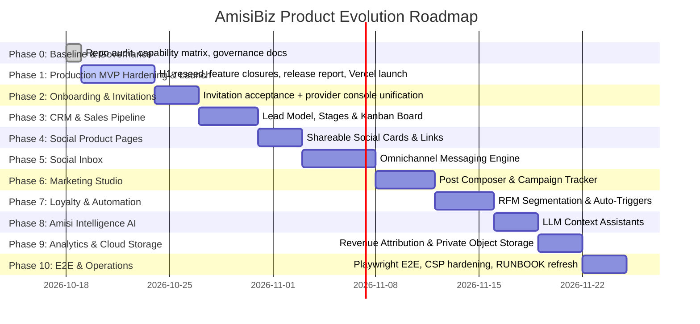

# AmisiBiz Engineering Roadmap & Agent Execution Plan

**Authority:** AGENT 00 — Chief Engineering Orchestrator  
**Status:** Canonical Implementation Roadmap  
**Execution Model:** Phased, Specialist-Agent Delegated, Dependency-Ordered  
**Updated:** 2026-10-18 (re-baselined at `ef191dd`: C1 closed on live Neon; the roadmap now starts from verified reality — the pre-MVP hardening track from `docs/implementation/orchestration/acceptance-backlog.md` is Phase 1)

---

## 1. Phased Execution Roadmap

---

## 2. Phase Breakdown & Specialist Agent Assignments

### Phase 0: Baseline & Governance — **DONE 2026-10-18**

- **Assigned Agent:** AGENT 00 (this orchestrator).
- **Scope:** Repository + architecture assessment; 17-point capability matrix (see `docs/IMPLEMENTATION_STATUS.md`); governance document refresh; baseline gates executed at `ef191dd`.
- **Evidence:** type-check 10/10, lint 10/10, tests 558 passed/33 skipped (24 files), build green, bundle scan clean (248 files/6.0 MB), `audit --prod` exit 0 (accepted 7-advisory baseline), live Neon 22/22 with empty live-vs-datamodel diff — executed 2026-10-18 against the working tree at HEAD `d79c520` including the owner's uncommitted in-flight work (`format:check` pending on 4 of those in-flight files). Deliverables: `docs/implementation/orchestration/agent-00-baseline-report.md`.

### Phase 1: Production MVP Hardening & Launch — **ACTIVE**

- **Assigned Agent:** This orchestrator (direct execution, per the R1 program).
- **Scope (from `orchestration/acceptance-backlog.md` items 5–7 and the A7 release report):**
  1. **H1:** reseed the permission catalog to the 57-key code matrix + parity tests; RLS harness 31/33 → 33/33 (#87).
  2. **R1 same-tenant composite FKs** on the register — sequenced AFTER the peer `DocumentItem`/`DocumentContactItem` remodel lands (#72 dependency; peer all-clear required).
  3. **Feature closures per backlog items 8–11** (#88): A5 financial-rule gaps in reservation order (#75, blocked by peer all-clear), storage provider implementation (critical path for acceptance row 11 — **owner must select and configure the provider**, `@vercel/blob` already installed), UX findings V1–V4 (#82/#83/#71/#73), invitation-delivery decision implementation.
  4. **Re-verification + release report** (#89): full gate + harness against the integrated tree; final acceptance matrix. **No deployment without explicit owner approval.**
  5. **Owner-side launch requirements:** Vercel Production env (`AUTH_SECRET` ≥32 chars, `NEXT_PUBLIC_APP_URL`, `DATABASE_URL`, plus recommended `APP_DATABASE_URL` + `STRICT_APP_ROLE="true"`); rotation of the Neon owner password and seed-admin password (both transited chat in plaintext).
- **Dependencies:** Peer all-clear gates the reserved document/contact/item surfaces.
- **Quality Gate:** Full gate chain green + 33/33 harness + empty live-vs-datamodel diff maintained; end-of-phase report in the 11-field format.

### Phase 2: Onboarding & Owner Invitation Acceptance

- **Assigned Agent:** `AGENT-AUTH-TENANCY`
- **Scope:**
  - Complete the owner invitation acceptance workflow (`/invitation/[token]` & `/auth/accept-invitation`).
  - Send branded invitation emails via Mailtrap when an operator invites an owner (closes UX V2 "success-without-delivery").
  - Reconcile `platform/*` and `admin/*` navigation shells into a unified Provider Console (retire the orphan `/platform` console — UX V1, owner nod on file as pending).
  - Retire or gate the self-serve `/register` auto-provisioning path (PRD requires provider-controlled onboarding).
- **Dependencies:** Phase 1 (builds on the verified, launch-ready foundation).
- **Quality Gate:** Automated tests for invitation token consumption, workspace claim, and password establishment.

### Phase 3: CRM Intelligence & Sales Lead Pipeline

- **Assigned Agent:** `AGENT-CRM-SALES`
- **Scope:**
  - Introduce `Lead` and `SalesPipeline` models to `schema.prisma` (with tenant scoping + RLS from day one).
  - Build interactive drag-and-drop Kanban Deal Board in the tenant workspace.
  - Implement one-click conversion: Lead → Won Deal → Quotation / Order (coordinates with the document surfaces' reservation status).
- **Dependencies:** Phase 2.
- **Quality Gate:** Migration passing `prisma migrate diff`, lead stage transition tests, conversion tests.

### Phase 4: Social Commerce Product Showcase & Public Links

- **Assigned Agent:** `AGENT-CATALOGUE-COMMERCE`
- **Scope:**
  - Generate shareable social product cards with OpenGraph meta tags for WhatsApp and Instagram.
  - Public tenant-branded product landing page (`<slug>.amisibiz.com/p/[itemId]`).
  - WhatsApp "Inquire / Buy" direct CTA button pre-populating item details.
- **Dependencies:** Phase 3.
- **Quality Gate:** OpenGraph rendering tests, shareable link routing tests, tenant-isolation verification.

### Phase 5: Unified Social Commerce Inbox

- **Assigned Agent:** `AGENT-SOCIAL-INBOX`
- **Scope:**
  - Introduce `Conversation` and `Message` models.
  - Multi-channel webhook handlers for WhatsApp Cloud API and Instagram DM (**Meta credentials provisioned**: App ID `1138557585402691`, Phone `+254700578380`).
  - Unified inbox UI with customer order sidebar and quick quotation generator.
- **Dependencies:** Phase 4.
- **Quality Gate:** Webhook deduplication tests, multi-channel message thread isolation tests.

### Phase 6: Social Media Marketing Studio & Campaign Tracking

- **Assigned Agent:** `AGENT-MARKETING-CAMPAIGNS`
- **Scope:**
  - Social post composer with image uploading and tenant branding watermarks.
  - Content planning calendar.
  - Campaign entity with UTM link generator and conversion funnel attribution.
- **Dependencies:** Phase 5 (publishing channels); storage provider (Vercel Blob enabled on dashboard).
- **Quality Gate:** Campaign click tracking and conversion attribution calculation tests.

### Phase 7: Customer Segmentation, Loyalty & Automation

- **Assigned Agent:** `AGENT-AUTOMATION-LOYALTY`
- **Scope:**
  - Automated customer RFM segmentation (Recency, Frequency, Monetary).
  - Dynamic customer tagging and loyalty points ledger.
  - Event-driven marketing automation triggers (welcome messages, payment reminders, win-back alerts) — requires a job/trigger substrate (none exists today; first background-job infrastructure lands here).
- **Dependencies:** Phase 6.
- **Quality Gate:** Trigger dispatch tests, loyalty balance assertion tests.

### Phase 8: Amisi Intelligence AI Assistant

- **Assigned Agent:** `AGENT-AI-INTELLIGENCE`
- **Scope:**
  - Context-aware social reply generator utilizing tenant catalogue and FAQs.
  - AI quotation cover note drafting.
  - Social marketing post copy generator.
  - **External dependency:** owner-selected LLM provider + API key; no AI key is configured today.
  - **Dependencies:** Phase 7.
- **Quality Gate:** Mocked LLM response contract tests, token safety tests, prompt injection protection. PII rules from the constitution apply to every prompt payload.

### Phase 9: Financial Analytics, Attribution & Cloud Storage

- **Assigned Agent:** `AGENT-ANALYTICS-STORAGE`
- **Scope:**
  - Complete the private-storage transition (Vercel Blob active on dashboard; `@vercel/blob` installed) with signed read URLs.
  - Net profitability analytics (Gross Revenue − Cost of Goods Sold) — requires item cost-price data.
  - Marketing channel revenue attribution reports (consumes Phase 6 campaign data).
- **Dependencies:** Phases 6–8.
- **Quality Gate:** Signed URL authorization tests, accounting balance verification tests.

### Phase 10: E2E Testing & Production Operations

- **Assigned Agent:** `AGENT-OPS-QA`
- **Scope:**
  - Playwright end-to-end suite for core journeys:
    1. Provider provisions and activates tenant.
    2. Owner accepts invitation and sets password.
    3. Tenant creates lead, converts to quotation, issues invoice, records payment.
    4. Portal customer signs in and downloads receipt PDF.
  - Security-header hardening (CSP et al. — currently absent, see capability #17) and `vercel.json` production configuration.
  - Refresh `docs/RUNBOOK.md` off the Supabase era onto Neon/Vercel operations (currently stale — flagged in the baseline report).
- **Dependencies:** Phases 2–9.
- **Quality Gate:** 100% green Playwright E2E suite on staging preview; security headers verified.

---

## 3. Coordination & Conflict Prevention Rules

1. **Schema Exclusivity:** Only the active specialist agent may modify `apps/web/prisma/schema.prisma` during their assigned phase. Parallel schema edits are strictly forbidden.
2. **Migration Forward-Only:** All schema updates must ship with a clean SQL migration file and pass `prisma migrate diff`; applied migrations are frozen — retired shells are superseded by new migrations, never edited (ADR-010).
3. **No Breaking Shared Interfaces:** Packages under `packages/*` require regression verification before consumption in `apps/web`.
4. **Reserved Surfaces (standing):** `apps/web/src/server/services/documents/*.ts` and `apps/web/src/server/actions/document*.ts` are reserved by the peer document agent until its all-clear; `Contact`/`Item` remodel toward `DocumentItem`/`DocumentContactItem` is pending. No new tests are added against contact, item, or document surfaces until the all-clear.
5. **Live-System Authorization:** Probes or migrations against the live Neon database, and any production deployment, require the owner's explicit go-ahead. A GO recommendation is never itself a deployment authorization.
6. **Honest Verification:** No phase is reported COMPLETE on the strength of generated code or a passing build; every claim cites executed verification (constitution §1.8, orchestrator reporting format).
